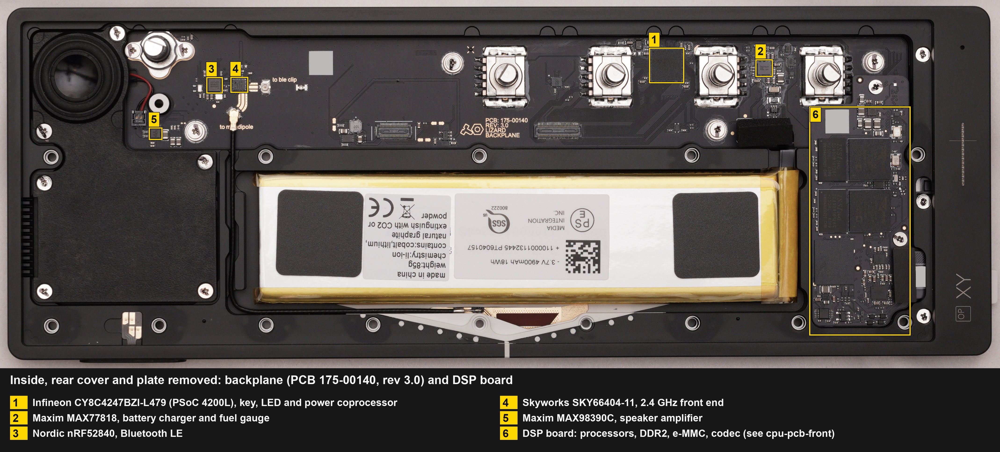
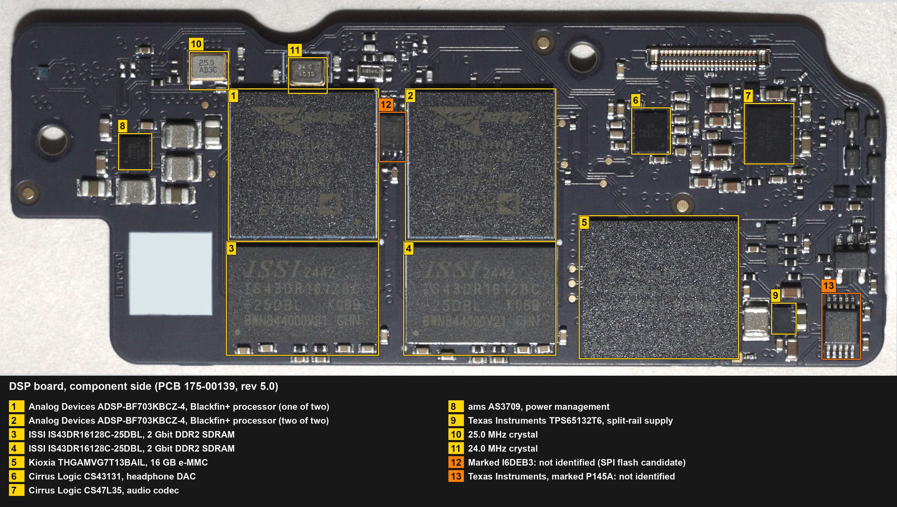
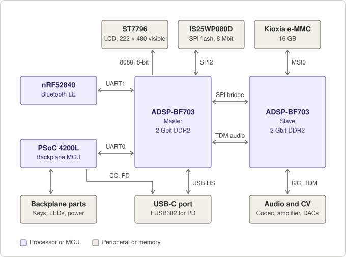

# OP-XY hardware reference

Photos and notes on the hardware inside the Teenage Engineering OP-XY: which chips are on the boards,
what they do, and where to find their public datasheets.

This is an unofficial community reference. It is not affiliated with or endorsed by Teenage Engineering.

## Contents

| Page | What it covers |
|---|---|
| [parts.md](parts.md) | Every identified IC: role, part number, how sure we are, bus, datasheet link |
| [diagrams.md](diagrams.md) | Block diagrams: how the chips connect and which board each is on |
| [boards/dsp.md](boards/dsp.md) | The DSP board: processors, memory, storage, audio converters |
| [boards/backplane.md](boards/backplane.md) | The backplane: coprocessor, charging, Bluetooth, speaker amplifier |
| [boards/keyboard.md](boards/keyboard.md) | The keyboard board |
| [photos/](photos/) | The photos, each board photo with an annotated copy |







The unit has three boards, named here by their silkscreen: **DSP** (`175-00139`), **backplane**
(`175-00140`) and **keyboard** (`175-00142`).

## Ground rules

- **No datasheets are hosted here.** Each part links to the manufacturer's product or document page.
  Where a page looks likely to move, a Wayback Machine snapshot is linked next to it.
- **Every identification states its source**: a chip's marking, an ID read back from the chip, the way the
  firmware drives the hardware, or an inference. An inference stays marked as one until a photo or ID
  read confirms it.
- **Hardware facts only.** No code or data from Teenage Engineering's firmware is reproduced here. Some
  links (which bus and address a chip answers on) and a few part names are known from how the firmware
  drives the hardware, and those entries say so.

## Leak check

`tools/leak-check.py` checks every commit and push for things that should not leave a maintainer's
machine: home directory paths, email addresses, camera metadata in a photo (location, time, serial
number), binary files outside `photos/`, and the maintainer's own private patterns. It reports the rule
and the place, never the text that matched.

```bash
python3 -I -B tools/leak-check.py tree
```

`tools/leak-check-install.sh` installs it as git hooks, and `tests/tools/test_leak_check.py` tests it.
It cannot see what is in a picture: cover serial labels by hand (see [photos/README.md](photos/README.md)).

## Contributing

Photos of chip markings are the most useful contribution: one close-up per chip, in focus, with the
marking readable. See [photos/README.md](photos/README.md) for naming. Corrections to a part ID go in a
pull request that says where the new ID comes from.
