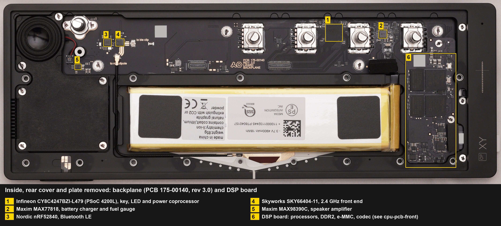

# Backplane

The long board under the rear plate. It carries the four encoders, the coprocessor, charging, Bluetooth
and the speaker amplifier, and the [DSP board](dsp.md) plugs into its right-hand end.

Original: [main-boards.jpg](../photos/main-boards.jpg). Only the side facing the rear plate has been
photographed.

## Parts on this board

Part numbers, confidence and datasheet links are in [parts.md](../parts.md). The numbers match the photo
above.

| No. | Marking | Part | Role |
|---|---|---|---|
| 1 | `CY8C4247BZI- / L479 TWN2249 / CYP 633964` | Infineon CY8C4247BZI-L479 (PSoC 4200L) | Key, LED and power coprocessor |
| 2 | `MAX77818 / EWZ / KVED 227` | Maxim MAX77818 | Battery charger and fuel gauge |
| 3 | `N52840 / CKAAD0 / 2241KU` | Nordic nRF52840 | Bluetooth LE |
| 4 | Skyworks logo, `66404` | Skyworks SKY66404-11 | 2.4 GHz front end between the nRF52840 and the antennas |
| 5 | `+MAX / 98390C / EWX / K 2429` | Maxim MAX98390C | Speaker amplifier, beside the speaker connector |
| 6 | — | The [DSP board](dsp.md), plugged in | |

These markings are too small to read in the photo above. They were read from close-ups that are not
published.

Also on this side, not numbered: a 32 MHz crystal and a smaller one beside the nRF52840, and four chips
whose markings are read but not identified (see
[parts.md](../parts.md#marking-read-part-not-identified)).

## Antennas

Two coaxial connectors sit after the front end. One is silkscreened `to ble clip`. The other carries the
thin black cable that runs down past the battery to the bottom edge; its label is partly covered by the
cable.

## Board markings

- Silkscreen: `PCB: 175-00140`, `REV: 3.0`, `LIZARD BACKPLANE`.
- Also marked `L1rev3.0`.

## Also in the photo

- **Battery:** lithium-ion, 3.7 V, 4900 mAh, 18 Wh, 85 g.
- **Speaker:** top left, on a two-wire lead to the backplane.
