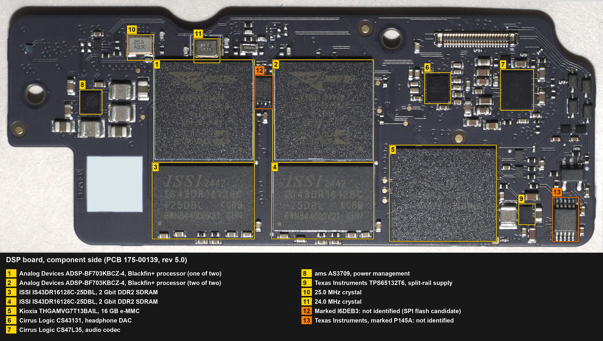
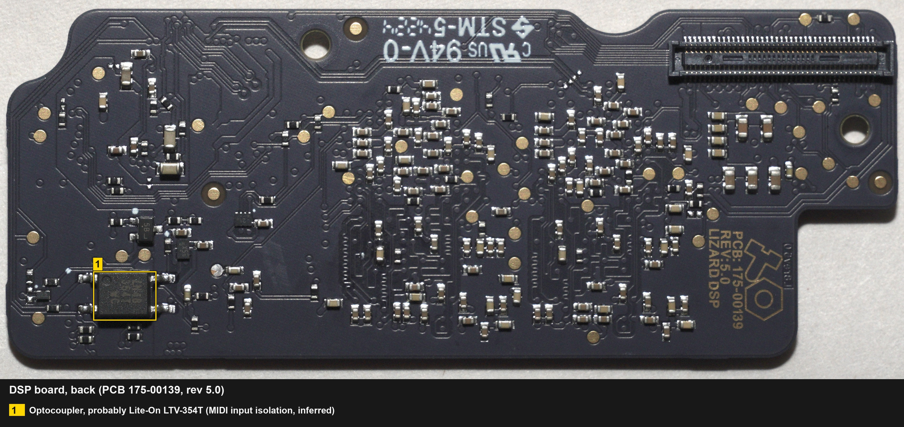

# DSP board

The processor board: both Blackfin+ processors, their memory, the storage and the audio converters. It
sits at the right-hand end of the [backplane](backplane.md) and has one board-to-board connector on each
side.

Originals: [component side](../photos/cpu-pcb-front.jpg), [back](../photos/cpu-pcb-back.jpg).

## Parts on this board

Part numbers, confidence and datasheet links are in [parts.md](../parts.md). The numbers match the photo
above.

| No. | Marking | Part | Role |
|---|---|---|---|
| 1, 2 | `ADSP-BF703 / KBCZ-4 / 6785746.1-1.1 / #2448 KOREA` | Analog Devices ADSP-BF703KBCZ-4 | The two processors. Which is the master is not yet traced |
| 3, 4 | `ISSI 2442 / IS43DR16128C / -25DBL` | ISSI IS43DR16128C-25DBL | 2 Gbit DDR2, one beside each processor |
| 5 | `THGAMVG7T13BAIL` | Kioxia THGAMVG7T13BAIL | 16 GB e-MMC |
| 6 | `CS43131 / A1BX2134` | Cirrus Logic CS43131 | Headphone DAC |
| 7 | `CS47L35 / NRA1CH2429 / TW` | Cirrus Logic CS47L35 | Audio codec |
| 8 | `ams / AS3709 / K2V0-10 / DEBA` | ams AS3709 | Power management, beside its inductors |
| 9 | `TPS / 65132T6` | Texas Instruments TPS65132T6 | Split-rail supply |
| 10 | `25.0 / AD3C` | 25.0 MHz crystal | Processor clock |
| 11 | `24.0 / AG39` | 24.0 MHz crystal | Probably the USB clock |
| 12 | `I6DEB3 / P1L944` | Not identified | 8-pad leadless package between the processors. A candidate for the SPI flash |
| 13 | `TI 34 / P145A / 751Z` | Not identified (Texas Instruments, 10-pin VSSOP) | Unknown |

### Back

| No. | Marking | Part | Role |
|---|---|---|---|
| 1 | logo, `N48 / 354T / WC` | Probably Lite-On LTV-354T | 4-pin optocoupler, probably the MIDI input isolation |

The back otherwise carries passives, a few small transistors and the second board-to-board connector.

## Board markings

- Back, gold silkscreen: `PCB: 175-00139`, `REV: 5.0`, `LIZARD DSP`.
- Component side: `L1rev5.0`.
- Back, white: the fabricator's mark `STM-5` and the UL flammability mark `94V-0`.
