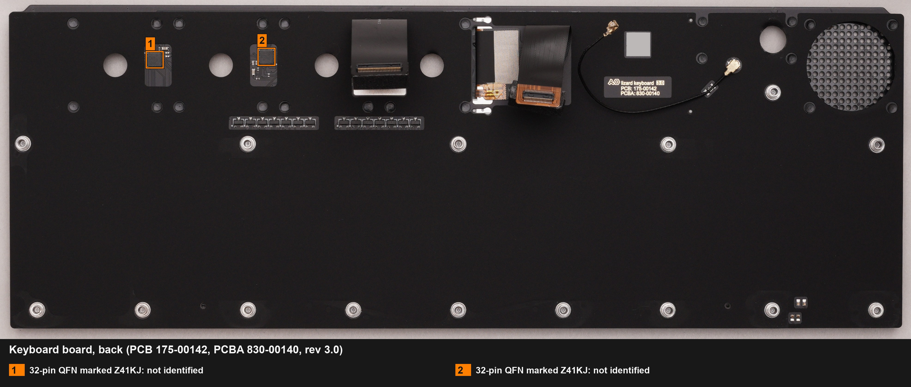

# Keyboard board

The large board behind the keys. Its back is covered by a black sheet with cut-outs, so only a few parts
show.

Original: [keys-back.jpg](../photos/keys-back.jpg). The key side has not been photographed.

## Parts on this board

| No. | Marking | Part | Role |
|---|---|---|---|
| 1, 2 | `Z41KJ / 3729` | Not identified (32-pin QFN) | Unknown. Two of the same chip, each in its own cut-out |

Also visible: two rows of seven small three-pin parts, two flex connectors, and the antenna cable that
runs to the [backplane](backplane.md).

## Board markings

- Label: `lizard keyboard 3.0`, `PCB: 175-00142`, `PCBA: 830-00140`.
