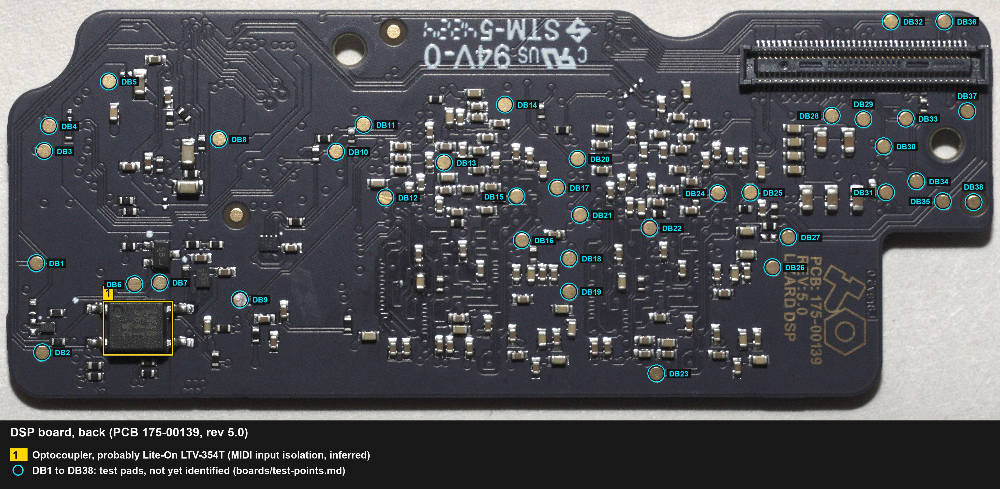
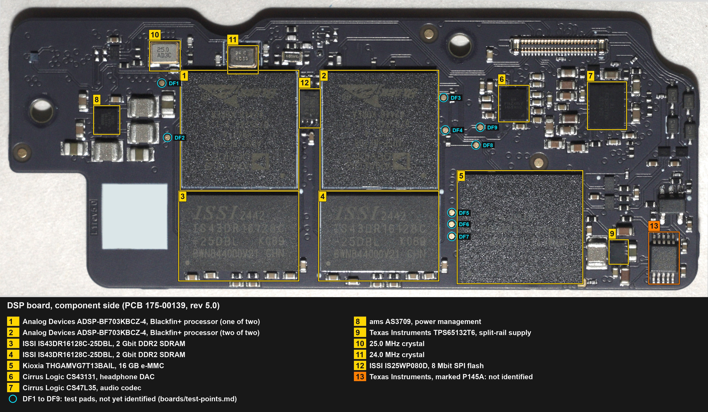
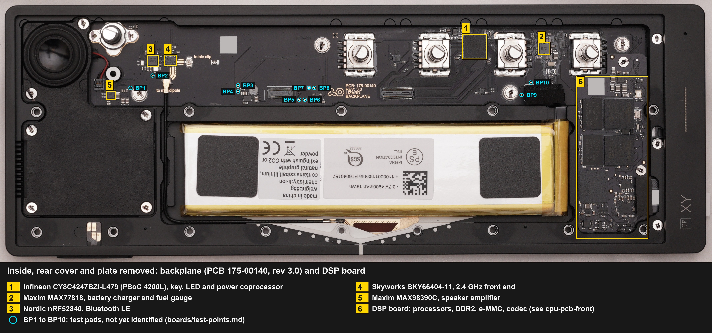

# Test points

Every exposed pad in the board photos that looks like a test point, numbered so that measurements can be
recorded against it. **None is identified yet**: the boards carry no test-point silkscreen, and the
Signal column stays `Not measured` until someone probes the pad and says how.

The numbers match the cyan circles on the annotated photos. The positions live in
[labels.json](../photos/labels.json) under `pads`, in pixels of the original photo.

## DSP board, back

38 pads, `DB1` to `DB38`, numbered left to right. This photo is mirrored left to right against the
component side, so "behind processor one" is where that chip sits when the two photos are overlaid. The
match is good to about a millimetre. A pad being behind a chip does not show that it connects to it.

| Pad | Centre (x, y) | Where | Notes | Signal |
|---|---|---|---|---|
| DB1 | 147, 1070 | Audio end, near the optocoupler | | Not measured |
| DB2 | 171, 1433 | Audio end, near the optocoupler | | Not measured |
| DB3 | 179, 614 | Audio end, behind the DAC and codec | | Not measured |
| DB4 | 198, 512 | Audio end, behind the DAC and codec | | Not measured |
| DB5 | 442, 331 | Audio end, behind the DAC and codec | | Not measured |
| DB6 | 546, 1156 | Audio end, near the optocoupler | | Not measured |
| DB7 | 649, 1149 | Audio end, near the optocoupler | | Not measured |
| DB8 | 889, 566 | Audio end, behind the DAC and codec | | Not measured |
| DB9 | 975, 1218 | Audio end, near the optocoupler | Covered in solder, unlike the others | Not measured |
| DB10 | 1366, 617 | Between processor two and the audio end | | Not measured |
| DB11 | 1478, 507 | Between processor two and the audio end | | Not measured |
| DB12 | 1567, 803 | Behind processor two | | Not measured |
| DB13 | 1805, 661 | Behind processor two | | Not measured |
| DB14 | 2053, 425 | Behind processor two | | Not measured |
| DB15 | 2100, 799 | Behind processor two | | Not measured |
| DB16 | 2121, 977 | Behind processor two | | Not measured |
| DB17 | 2265, 763 | Between the two processors | | Not measured |
| DB18 | 2314, 1051 | Between the two processors | | Not measured |
| DB19 | 2314, 1186 | Between the two DDR2 chips | | Not measured |
| DB20 | 2348, 646 | Between the two processors | | Not measured |
| DB21 | 2358, 874 | Behind processor one | | Not measured |
| DB22 | 2641, 927 | Behind processor one | | Not measured |
| DB23 | 2669, 1519 | Behind the DDR2 of processor one | | Not measured |
| DB24 | 2918, 786 | Behind processor one | | Not measured |
| DB25 | 3051, 783 | Between processor one and the power end | | Not measured |
| DB26 | 3141, 1087 | Between processor one and the power end | | Not measured |
| DB27 | 3205, 964 | Between processor one and the power end | | Not measured |
| DB28 | 3382, 470 | Power end, behind the AS3709 and its inductors | | Not measured |
| DB29 | 3511, 485 | Power end, behind the AS3709 and its inductors | | Not measured |
| DB30 | 3593, 595 | Power end, behind the AS3709 and its inductors | | Not measured |
| DB31 | 3603, 782 | Power end, behind the AS3709 and its inductors | | Not measured |
| DB32 | 3622, 87 | Beside the board-to-board connector | | Not measured |
| DB33 | 3683, 482 | Power end, behind the AS3709 and its inductors | | Not measured |
| DB34 | 3726, 737 | Power end, behind the AS3709 and its inductors | | Not measured |
| DB35 | 3834, 818 | Power end, behind the AS3709 and its inductors | | Not measured |
| DB36 | 3840, 87 | Beside the board-to-board connector | | Not measured |
| DB37 | 3933, 452 | Power end, behind the AS3709 and its inductors | | Not measured |
| DB38 | 3959, 822 | Power end, behind the AS3709 and its inductors | | Not measured |

Not numbered: two gold dots with a wide bare ring round them, top centre and centre left. They look like
fiducials for the assembly machines.

## DSP board, component side

9 pads, `DF1` to `DF9`. They are smaller than the pads on the back.

| Pad | Centre (x, y) | Where | Notes | Signal |
|---|---|---|---|---|
| DF1 | 937, 481 | Left of processor one, beside the power inductors | | Not measured |
| DF2 | 970, 796 | Left of processor one, beside the power inductors | Small hole in the centre | Not measured |
| DF3 | 2570, 565 | Right edge of processor two | | Not measured |
| DF4 | 2580, 753 | Right edge of processor two | | Not measured |
| DF5 | 2618, 1232 | Between the DDR2 of processor two and the e-MMC | Row of three, each with a trace toward the e-MMC | Not measured |
| DF6 | 2618, 1298 | Between the DDR2 of processor two and the e-MMC | Row of three | Not measured |
| DF7 | 2618, 1370 | Between the DDR2 of processor two and the e-MMC | Row of three | Not measured |
| DF8 | 2757, 840 | Between processor two and the headphone DAC | On a trace; small hole in the centre | Not measured |
| DF9 | 2782, 737 | Between processor two and the headphone DAC | On a trace | Not measured |

Not numbered: three ringed fiducials (far left, top centre, and above the e-MMC).

## Backplane

10 pads, `BP1` to `BP10`, on the one side that has been photographed. No pad is visible beside the
PSoC on this side, so its debug pads, if it has any, are on the other side or reached through a connector.

| Pad | Centre (x, y) | Where | Notes | Signal |
|---|---|---|---|---|
| BP1 | 783, 528 | Between the speaker amplifier and the nRF52840, beside a screw | Two very small pads side by side | Not measured |
| BP2 | 916, 454 | Below the nRF52840 | Round, with a dot in the centre; may be a fiducial | Not measured |
| BP3 | 1429, 513 | Left of the left-hand board-to-board connector | Oblong, upper of a pair | Not measured |
| BP4 | 1429, 550 | Left of the left-hand board-to-board connector | Oblong, lower of a pair | Not measured |
| BP5 | 1797, 599 | Right of the left-hand board-to-board connector | Oblong, left of a pair | Not measured |
| BP6 | 1830, 599 | Right of the left-hand board-to-board connector | Oblong, right of a pair | Not measured |
| BP7 | 1855, 528 | Right of the left-hand board-to-board connector | Oblong, left of a pair | Not measured |
| BP8 | 1887, 528 | Right of the left-hand board-to-board connector | Oblong, right of a pair | Not measured |
| BP9 | 3132, 571 | Beside the screw left of the DSP board | | Not measured |
| BP10 | 3187, 496 | Beside the screw left of the DSP board | | Not measured |

The oblong pairs may be unfitted two-pad parts or solder jumpers rather than probe points. The gold
shapes between the front end and the antenna connectors are radio-frequency traces, not test pads.

## What to look for

Pin names are from the manufacturers' datasheets (linked in [parts.md](../parts.md)). Take ball and pin
numbers from there.

| Chip | Debug and boot signals |
|---|---|
| ADSP-BF703 (two) | JTAG or SWD: `JTG_TCK_SWCLK`, `JTG_TMS_SWDIO`, `JTG_TDO_SWO`, `JTG_TDI`, `JTG_TRST`. Boot and reset: `SYS_HWRST`, `SYS_BMODE0`, `SYS_BMODE1`, `SYS_FAULT`, `SYS_CLKOUT`. UART0 is also a boot source |
| CY8C4247 (PSoC 4200L) | SWD: `SWDIO`, `SWDCLK`, and reset `XRES` |
| nRF52840 | SWD: `SWDIO`, `SWDCLK`, and `nRESET` |

The BF703 is a ball-grid package, so a pad cannot be traced to a ball with a meter. The debug port may
also be locked in the processor's one-time-programmable memory.

## How to identify a pad

1. **Unpowered, battery unplugged.** Find ground, then note each pad's diode-mode reading to ground. Power
   rails and plain signals separate quickly, and two pads that read alike, one near each processor, are
   likely the same signal on each.
2. **Powered.** Note each pad's idle voltage, then watch it through a boot with a scope or logic analyser.
   Debug pins sit still at a rail or at ground; a UART idles high and sends bursts; a clock is plain.
   Measure the I/O voltage before connecting any tool.
3. **Scan.** Wire the pads that sit still to a JTAG pin finder and run an IDCODE scan and an SWD scan.

When a pad is identified, put the signal in the table with how it was found, for example
`3.3 V rail (meter)` or `JTG_TCK (IDCODE scan)`.
