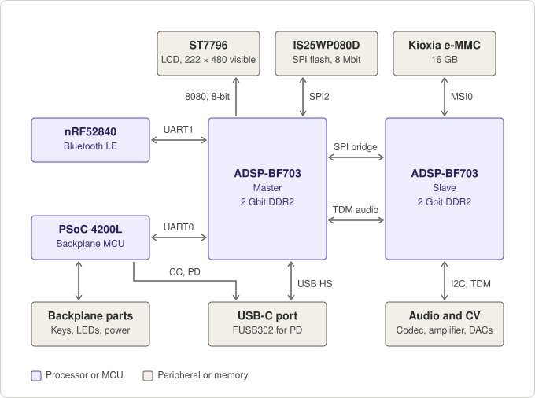
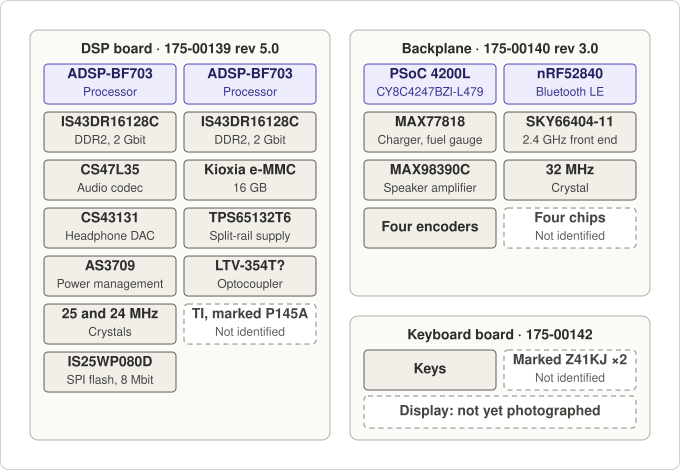
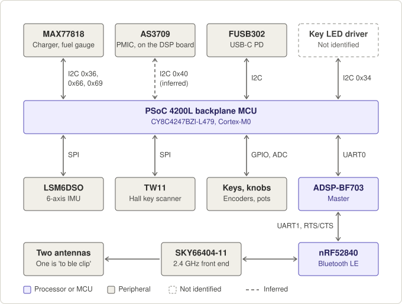
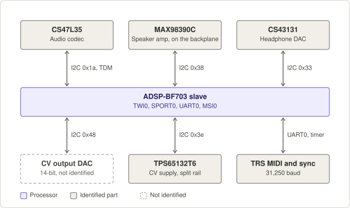

# Diagrams

How the chips in [parts.md](parts.md) connect, and which board each one is on.

- **Placement** comes from the photos: a chip is drawn on the board it was photographed on.
- **Links** are the ones in [parts.md](parts.md). The photos show where a chip sits, not where its traces
  go, so most links are known from how the device's firmware drives the hardware.
- **A dashed line** is an inferred link. **A dashed box** is a part that is not identified yet.
- **To change a diagram**, edit `tools/diagrams.py` and run it. It writes the SVG files in `diagrams/`.

## Overview

Two ADSP-BF703 processors share the DSP board. One is strapped as the master and the other as the slave;
which physical chip is which has not been traced. An SPI bridge and a TDM audio link join them. A PSoC on
the backplane looks after the keys, LEDs and power, and an nRF52840 does Bluetooth.

## Boards

Which chips the photos show on each board.

## The PSoC and the radio

The PSoC owns power, USB-C negotiation, the keys, the LEDs and the motion sensor; the processors reach
those parts only through it. The AS3709 is drawn dashed because matching it to the PMIC at `0x40` is an
inference. The FUSB302, LSM6DSO and TW11 are named by the firmware and not yet found in a photo. The
nRF52840 hangs off the master's second UART.

## Audio and CV

Every audio and CV chip sits on the slave's I2C bus. They are on the DSP board with it, apart from the
speaker amplifier, which is on the backplane by the speaker connector.

## What the photos added

- **Part numbers** for boxes that were only roles before: the codec, the speaker amplifier, the PSoC, the
  Nordic chip, the DDR2 and the charger.
- **Three boards**, and which chips are on each. Two placements are not where the wiring would suggest:
  the speaker amplifier is on the backplane, and the AS3709 power chip is on the DSP board.
- **One 25 MHz crystal** beside two processors, with a 24 MHz crystal next to it.
- **A radio front end** between the nRF52840 and two antenna connectors.

The photos did not add links. Which pins carry each bus still has to be traced or measured.
